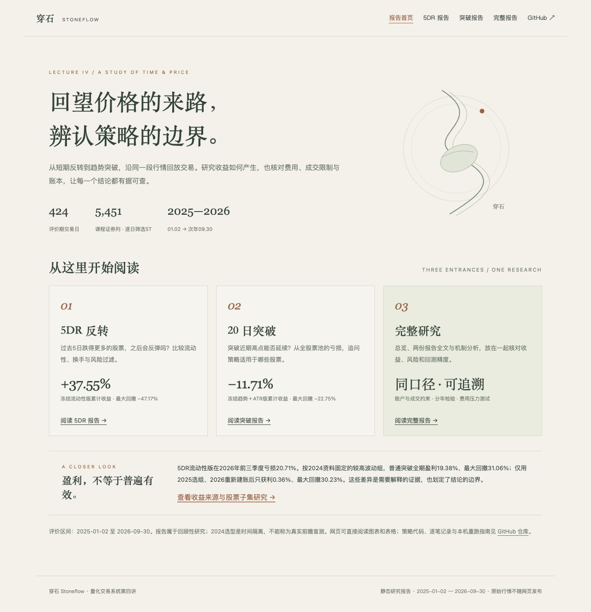

# 穿石 Stoneflow

**沿时间回放交易，让每一笔决策都有据可查。**

量化交易系统第四讲作业：日频事件驱动回测系统、5DR反转研究与趋势突破对照。仓库同时提供**无需原始数据的网页研究报告**和**读取课程Feather、可重新运行回测的本机系统**。

## 作业阅读入口

| 内容 | 网页版（Pages发布后生效） | GitHub文字版 |
| --- | --- | --- |
| **5DR报告**：基础策略、4个改进、分年及成本压力检验 | [阅读5DR](https://chuboxiao.github.io/stoneflow-quant/5dr.html) | [5DR全文](REVIEW_5DR.md) |
| **突破报告**：全池20日突破、风险控制、收益来源与适用股票 | [阅读20日突破](https://chuboxiao.github.io/stoneflow-quant/breakout.html) | [突破全文](REVIEW_BREAKOUT.md) |
| **完整报告**：总览＋两份报告全文＋机制与股票子集分析 | [阅读完整报告](https://chuboxiao.github.io/stoneflow-quant/full.html) | [总览](REVIEW_LECTURE4.md) · [5DR](REVIEW_5DR.md) · [突破](REVIEW_BREAKOUT.md) |

[网页报告首页](https://chuboxiao.github.io/stoneflow-quant/) · [机制与股票子集专页](ANALYSIS_STRATEGIES.md) · [拟提交评论（待审核）](SUBMISSION_LECTURE4_DRAFT.md)

**本次审核状态：代码和网页已在本机准备；尚未推送、启用Pages或发布新评论。上表在线地址是预定入口，发布并验证后才可访问。** 仓库内`.html`文件的GitHub预览不等于已托管网页。现在可下载仓库后，直接在浏览器打开[`report_site/index.html`](report_site/index.html)，无需Python和原始行情，也无需启动服务。完整报告包含可阅读的图表、表格和说明，不限于截图或Markdown。

在线报告为只读研究结果；修改参数、运行自定义策略及重新回测，需要下文的本机系统。[网页打包与发布说明](docs/REPORT_SITE.md)。

macOS可双击[`OpenReports.command`](OpenReports.command)，在默认浏览器离线打开报告首页；无需预览服务持续运行。`127.0.0.1:8768`仅在本机预览服务运行时有效。

## 本次更新：全股票池5DR与20日突破

评价区间固定为老师指定的 **2025-01-02 至 2026-09-30（424个交易日）**。在课程5,451列证券中按逐日历史ST状态筛选，完成5DR的5个方案，并扩展20日突破的5个方案与固定半仓诊断。两个策略家族各自用2024年选型，评价期不重新选冠军。这是回顾性时间隔离研究，不是真正盲测。

新增[收益来源与适用股票研究](ANALYSIS_STRATEGIES.md)：对账归因、共同股票池的后续报价、2024固定特征子集、2025选组后2026重新建账。高波动固定组在本样本盈利，但跨期重新建账优势很弱；不把事后盈利股票当作永久适用名单。

启动服务后访问 **http://127.0.0.1:8765/5dr** 与 **http://127.0.0.1:8765/breakout**；`/`保留原个股实验。新引擎使用原始股份、现金、股利应收及股份锁定，并独立重放账本。当前71项单元测试通过；主研究39组及补充研究17组账户分别通过账本重放。这次改动尚未推送或重新提交课程issue，等待审核。

[5DR复现与精度边界](docs/PRECISION_5DR.md) · [突破复现与精度边界](docs/PRECISION_BREAKOUT.md)

原始课程数据和辅助历史数据缓存均不上传；仓库内派生结果可以直接阅读，完整重跑需按指南下载辅助数据。



## 课堂任务（保留）

- **任务一**：模拟时钟、可编程策略接口、模拟券商、目标持仓、现金/持仓/订单记录、费用和滑点、T+1、cumadj复权、涨跌停限制、旧估值标记、本机网页、运行历史和报告导出。
- **任务二**：长源东谷603950.SH与科大讯飞002230.SZ，分别运行普通20日突破、成交额确认突破、买入并持有。两只股票各占一半初始资金，独立记账，不互相挪用现金。

[研究报告](REPORT.md) · [逐笔与记账说明](docs/ENGINE.md) · [拟提交评论（待审核）](SUBMISSION_COMMENT.md)

## 运行网页

Python 3.10+，推荐3.12。在仓库目录执行：

```bash
python3 -m venv .venv
source .venv/bin/activate
python -m pip install -r requirements.txt
python web_server.py --data-dir /你的路径/feathers
```

打开 http://127.0.0.1:8765 。只绑定本机，不上传行情、不连接券商，也不发送真实订单。

课程数据从[第四讲issue](https://github.com/aslan9/pku_quantllm/issues/8)下载。也可以将七个文件放入`data/feathers/`，再直接`python web_server.py`。本机已有的`local_config.json`可记录数据路径，此文件及原始Feather不进入Git。完成依赖安装后，macOS也可双击`Start.command`启动。

网页可选择三组研究或等权流程演示、调整区间/资金/费用/滑点、导入精确涨跌停CSV、切换成交模式、查看净值/回撤、分股比较、成交/拒单/持仓、运行历史并导出报告。

## 重跑研究与测试

```bash
python research.py --data-dir /你的路径/feathers
python run_demo.py --data-dir /你的路径/feathers
python -m unittest discover -s tests -v
python validate_results.py
```

上述命令重跑的是原突破实验，共同区间2020-07-01至2026-10-16，共1526个交易日；此前行情仅用于指标预热。输出为`results/research/`；六个独立子账户保存在其`subaccounts/`内。`validate_results.py`检查已保存账本，因此运行前保留或重建演示与严格模式结果。当前71项单元测试不需要下载课程数据，使用合成小样本。新的5DR与全池突破实验见各自复现指南。

## 策略是代码，不限于参数模板

引擎接收独立Python对象的`on_close(context)`。策略可以保存内部状态、结合多个行情字段、检查真实模拟持仓、实现任意条件和返回目标仓位；不需要改动引擎。突破策略在持仓时只判断退出条件，未触发时保持原持仓，不每日重置权重；订单失败后按照实际持仓继续判断。

```python
class MyStrategy:
    def on_close(self, context):
        history = context.history('close', lookback=21, adjusted=True)
        # 在这里编写状态、组合条件或自己的模型。
        return None   # 保持原持仓
        # return {}   # 下一次开盘尝试清仓
        # return {'603950.SH': 0.5}  # 下一次开盘尝试达到目标权重
```

`None`表示不下新指令；权重映射表示新目标，省略的证券目标为0。历史接口只返回截至当前日期的副本。当前通用范围是日频目标仓位策略；没有盘中事件、限价单撤改、做空、保证金或完整实盘订单生命周期。复杂策略逻辑可扩展，不等于已实现全部交易机制。

## 原突破实验的账户与成交边界

以下是旧版 `BacktestEngine` 和 `results/research/` 的口径；新5DR研究使用 `PrecisionEngine`，具体差异见新审核报告，不能把两种结果直接拼接。

**复权单位账户。** 价格比较使用原价×cumadj/固定基准因子，成交检查保留原价。累计因子无法还原每次现金分红、送股、配股与到账日，所以持仓输出为复权单位和模型等价股数，不能当作券商登记股数；没有虚构现金分红账本。

**涨跌停资料不足。** `strict`模式需要外部精确涨跌停资料；缺资料拒单。资料齐全时涨停拒买、跌停拒卖。`conservative`模式按因子近似还原参考前收，以向内一分钱的5%边界保守保护，可能过度拒单，也不能证明识别所有历史涨停。网页与报告持续标明代理；本文绩效均为代理下的教学结果，不能宣称精确成交复现。

另外，全天成交额非正或缺失的日期，会**事后否决成交**。全天零成交额是执行不可行性的证明，属于日线执行检查，不作为盘前可获知的选股信息；未使用当日高低收盘价回头决定开盘成交。严格的逐事件实盘验证仍需盘前停牌资料与更细粒度数据。

费用：佣金万三、最低5元、滑点5bps；卖方印花税在2023-08-28前后分别千分之一/万分之五。暂未覆盖全部过户等收费。每个子账户98%目标投资比例；期末不强制清仓。

## 文件结构

- `backtest/`：数据、时钟、策略接口、突破策略、券商、撮合限制、统计与导出。
- `research.py`：六个独立子账户和三组研究汇总。
- `web_server.py`、`web/dist/`：本机API与暖纸色网页。
- `report_site/`：无需服务的网页报告首页、5DR、突破、完整报告和机制分析；本机打开或由Pages托管均可。
- `build_report_site.py`：仅用Python标准库，从已保存报告打包上述站点，不重新回测。
- `research_5dr.py`、`research_breakout.py`：同区间全池反转与突破研究，2024选型、评价、压力情景及归因诊断。
- `tests/`：71项测试，涵盖两个引擎、状态型策略、复权、分红、送转锁股、因果性和网页任务。
- `results/5dr_review/`、`results/breakout_review/`：本次审核用真实派生结果、逐笔账本、独立HTML报告与校验。
- `results/research/`：研究指标、每日资产、订单、持仓、信号和子账户记录。
- `examples/daily_limits_TEMPLATE.csv`：精确资料模板，`date,symbol,upper_limit,lower_limit,no_limit,suspended`。
- `.github/workflows/tests.yml`：GitHub Actions测试；不依赖未上传的课程行情。
- `.github/workflows/report-pages.yml`：审核后手动发布只读报告的Pages工作流，不随push自动发布。

原始数据、虚拟环境、本机路径配置、临时网页运行历史均已忽略。仓库提供代码与派生研究记录，源数据请使用课程官方下载链接。
