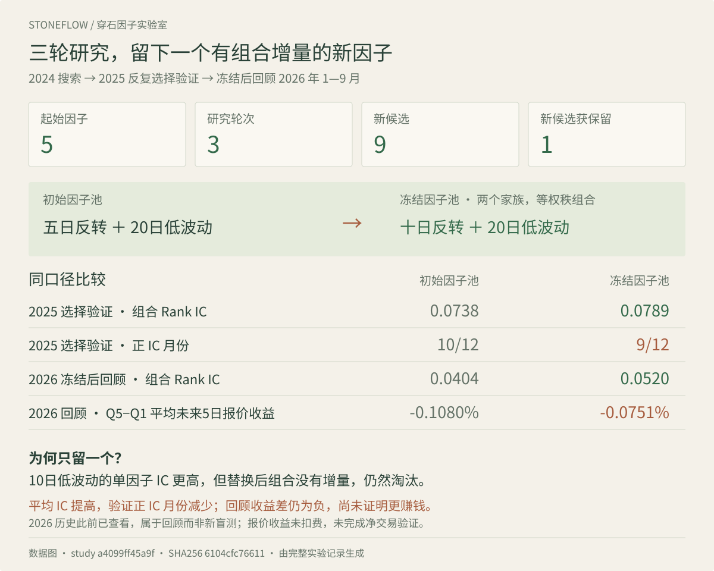
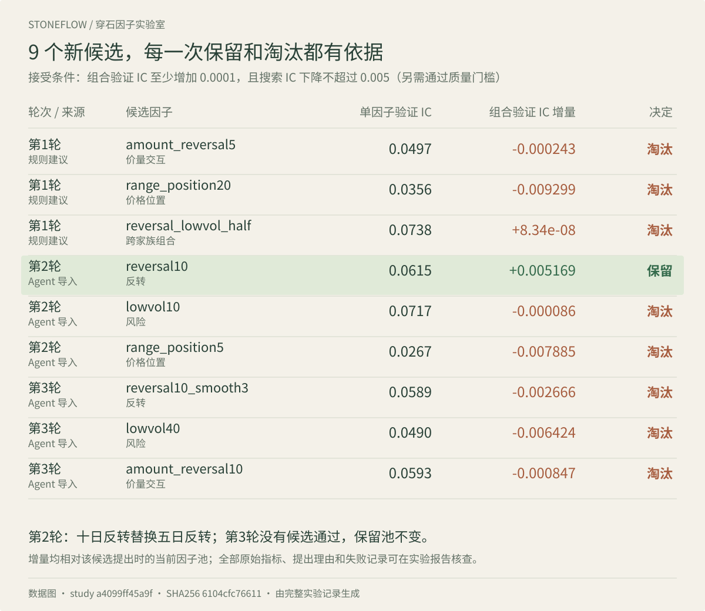
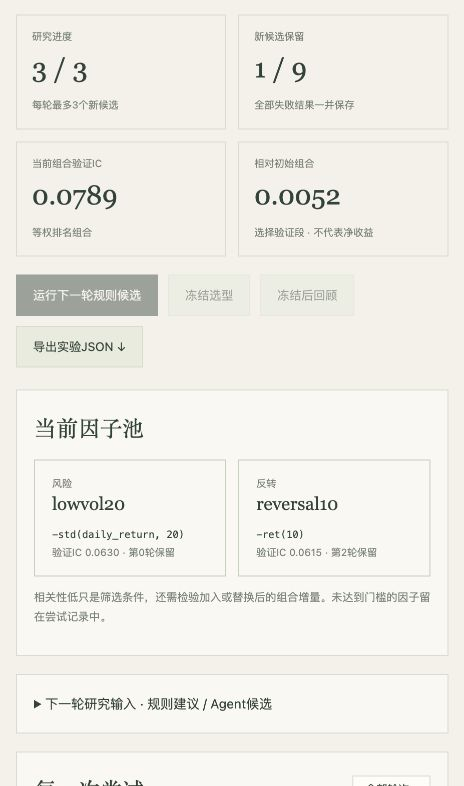
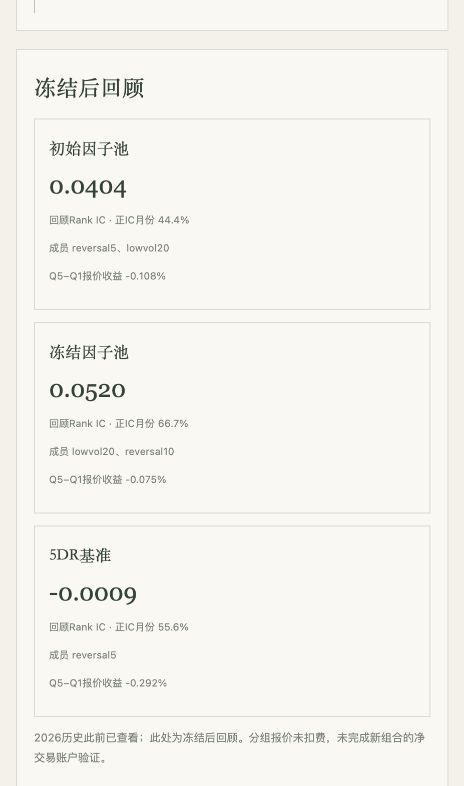

# 因子改进 · 第六讲作业

穿石新增了可运行的因子改进模块：创建研究、评价初始因子、提出候选、读取反馈、逐轮筛选、冻结选型和回顾检查。实验保存在本机，刷新页面或重启服务后可继续。报告由保存的实验记录生成。

**本次结果：**5个起始因子、3轮9个新候选，接受1个。十日反转替换五日反转，与20日低波动组成最终因子池。选择验证段组合Rank IC从0.0738升至0.0789；2026回顾从0.0404升至0.0520。但回顾段Q5−Q1报价收益仍为负，未完成新组合的净交易验证，不能据此宣称更赚钱。

[实验报告](results/evolution_runs/a4099ff45a9f/REPORT.md) · [全部实验记录](results/evolution_runs/a4099ff45a9f/study.json) · [逐候选CSV](results/evolution_runs/a4099ff45a9f/candidates.csv)

**实验数据图（非网页截图）**：下方两图根据保存的实验记录重新排版，用于展示候选筛选与结果对比；本机操作页面采用不同布局。





以上为实验记录生成的矢量数据图，点击可放大查看。数据源与指纹保留在图中；运行 `python tools/render_evolution_figures.py` 可重新生成。

<details>
<summary>查看实际模块页面：因子池与冻结后回顾</summary>

页面截图按原始宽度展示，避免放大模糊。完整候选可在下方的只读交互快照中筛选和展开。




</details>

## 使用入口

在仓库根目录双击`Start.command`，进入 **因子实验室 → 因子改进**，或打开 [本机模块](http://127.0.0.1:8765/factors/improve)。首次运行需要课程7个Feather矩阵、历史ST/交易状态资料与`local_config.json`，沿用[启动指南](docs/START.md)。

没有课程数据也可以阅读本文件、实验报告与截图。下载仓库后，双击`report_site/evolution.html`可打开独立的只读交互快照，无需Python或网络。GitHub文件页显示HTML源码；本次推送不自动部署GitHub Pages。

1. 新建研究，设置股票池、搜索段、选择验证段、预测期限和轮次预算。默认流动性池保留近20日均成交额≥2000万元、股价≥3元的限制，与此前较好的5DR版本一致。
2. 运行5个起始因子：五日反转、20日动量、20日突破、成交额放大、20日低波动，涵盖4个家族。
3. 点击“运行下一轮规则候选”，或展开研究输入区，把反馈交给Agent，再粘贴结构化候选JSON。候选只允许支持的算子，不执行任意Python。
4. 查看每个候选的公式、父因子、假设、两个区间的指标、相关性、组合增量和决定。每轮结束都可停止，全部失败记录保留。
5. 用完预算或主动结束后冻结选型，再运行2026回顾。冻结后不允许继续改选；继续探索需新建实验。

关闭浏览器不终止后端计算。服务退出时中断的批次保留原请求和已经完成的候选；再次启动后点击“继续未完成批次”。临时分数矩阵存于被Git忽略的`data/evolution_cache/`，删除缓存只会触发重新计算。

## 本次Harness改动

| 环节 | 10月30日探索脚本 | 当前模块 |
| --- | --- | --- |
| 实验管理 | 固定目录、固定日期、依赖临时缓存 | 独立实验ID、可配置区间、持久记录、断点续跑 |
| 候选生成 | 对话中提出后交给脚本 | H0固定次序规则基线；H1按池外家族与失败次数调整顺序；也支持Agent导入 |
| 筛选 | 子因子IC高于父因子，正IC月份占比不得下降 | 两段质量门槛＋家族/相关性筛选＋等权组合增量 |
| 多样性 | 最后挑选不同家族 | 提案阶段覆盖不同家族，入池时验证是否增加组合信息 |
| 反馈 | 手动阅读文件 | 页面呈现决定；生成结构化反馈供下一轮使用 |
| 结果 | 单次报告 | 可继续操作的实验、完整台账、只读快照与报告 |

H0/H1在这里表示**当前模块的两种提案规则**，与旧实验中对话提示的H0/H1标签不是同一个受控版本。当前没有后台LLM调用或模型训练。本次第1轮使用H1规则建议，第2、3轮由Codex根据实际反馈提出JSON并通过页面导入。因此这是**Agent辅助的因子研究工作流**，不是独立运行的LLM自进化系统。

本次没有运行相同预算的H0/H1对照，不能把结果提升归因于Harness本身更优。

## 固定的评价与接受规则

2024为搜索段，2025为选择验证段；两段都参与反复选型。2026历史此前已经查看，本次仅冻结后回顾，不能称为新盲测。

- 每轮最多3个候选，默认最多3轮。名称不同但公式参数相同的候选会被拦截。
- 方向预先固定，使用有符号Rank IC，不根据结果取绝对值或翻转方向。
- 候选在两个区间均须平均IC>0、正IC月份比例≥50%、因子覆盖率≥95%。
- 同家族或平均绝对每日秩相关>0.8的池成员先被列入替换范围；相关性在搜索与选择验证区间按当日合格股票计算。
- 对拟议因子池按当日合格股票的百分位秩等权组合，要求所有成员均有值。相对当前池，选择验证IC须至少增加0.0001，搜索IC下降不得超过0.005，最多保留5个成员。
- 初始池也按固定次序和同一组合增量规则建立；因此存在顺序依赖。没有通过门槛的因子不会为了凑家族而强行入池。
- 所有报价标签终点不越过各自区间截止日。每个候选核对截断未来数据前后的历史分数一致。

该规则允许稳定性与预测能力存在取舍。例如本次组合的选择验证正IC月份从10/12降至9/12，虽然平均IC增加。这一取舍保留在结果中，后续可在新实验里研究更严格的组合稳定性约束。

## 实现和复现

核心在[`factorlab/evolution.py`](factorlab/evolution.py)，复用既有`factorlab.core.evaluate`，不重写IC、标签或股票池口径。网页通过`web_server.py`提交真实后台任务；`web/dist/evolution.*`展示同一份保存状态。

```bash
# 已按启动指南安装依赖并连接本机数据
python -m factorlab.evolution create --request examples/evolution_experiment.json
python -m factorlab.evolution run --id 上一步返回的ID
python -m factorlab.evolution propose --id 上一步返回的ID
python -m factorlab.evolution run --id 上一步返回的ID --request 候选请求.json
python -m factorlab.evolution freeze --id 上一步返回的ID
python -m factorlab.evolution review --id 上一步返回的ID

# 用保存的提案按原顺序重放本次实验，创建新的实验ID
python tools/replay_evolution.py --source results/evolution_runs/a4099ff45a9f/study.json

# 不需要行情：独立核对每日统计与汇总，再生成便携快照
python tools/verify_evolution.py --id a4099ff45a9f
python build_report_site.py
python build_report_site.py --check
python -m unittest discover -s tests -v
```

实验状态与逐日诊断保存在`results/evolution_runs/<id>/`；数据和代码指纹、配置指纹、每轮原始请求、来源、父子关系、失败理由和冻结时间均可核查。原始行情、辅助状态缓存、临时分数矩阵和本机配置不提交。

## 当前边界

本模块完成预测层的因子改进。新的组合尚未接入网页中的净交易任务；需要进一步在相同持仓、成本、涨跌停和公司行为口径下验证。IC不等于可交易收益，分组报价也没有扣费。行业、市值中性化和风险暴露归因尚未加入；“不同家族”与低相关性不能保证经济风险独立。

当前保存的是已执行研究和已冻结规则。后续接入模型API、增加新算子、修改接受标准或使用新数据，应创建新实验并保留原版本。
