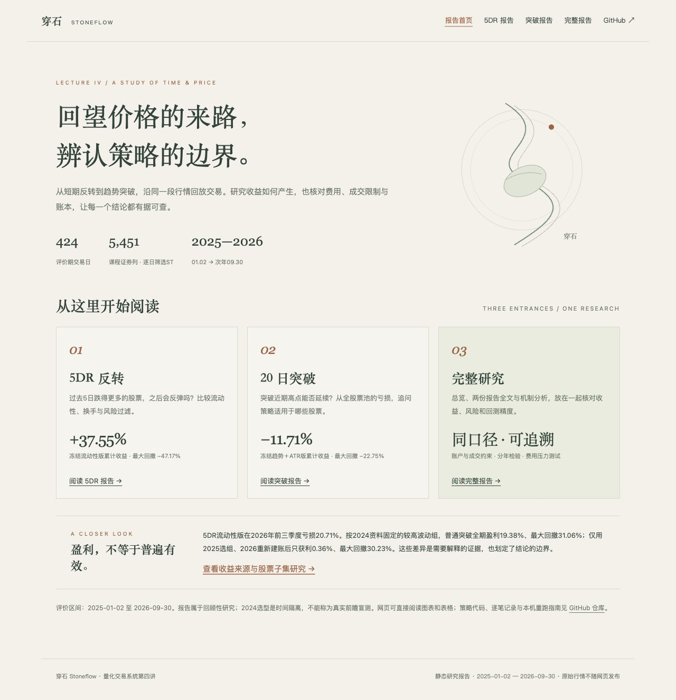

# 策略研究 · 穿石 Stoneflow

[实验室总览](README.md) · [回测系统](README_BACKTEST.md) · [因子评价](README_FACTORS.md) · [启动指南](docs/START.md)

本页保留原个股与全股票池实验、收益口径、研究报告和课程要求对应关系。具体因子的预测统计单独维护于[因子评价README](README_FACTORS.md)。

## 策略研究

| 研究方向 | 核心问题 | 评价区间 | 报告 |
| --- | --- | --- | --- |
| 全股票池5DR | 短期反转的表现能否通过流动性、换手和风险过滤改善？ | 2025-01-02至2026-09-30 | [5DR研究](REVIEW_5DR.md) |
| 全股票池20日突破 | 趋势过滤和仓位控制能否改善突破？哪些股票组更适合？ | 2025-01-02至2026-09-30 | [突破研究](REVIEW_BREAKOUT.md) · [收益来源与适用股票](ANALYSIS_STRATEGIES.md) |
| 两股趋势对照 | 成交额放大确认，能否改善长源东谷与科大讯飞的突破表现？ | 2020-07-01至2026-10-16 | [个股实验](REPORT.md) |

研究保留盈利与亏损方案，结合回撤、仓位和费用解释结果。训练期选型与评价期分开，但这些实验是在看到部分历史结果后回顾整理，不能称为真正的前瞻盲测。

### 全股票池：5DR与20日突破

主评价区间为 **2025-01-02至2026-09-30，共424个交易日**。在课程5,451列证券中，按逐日历史ST状态与已有行情筛选，排除ST／*ST和未知状态的新买入；课程名单是否覆盖完整历史市场仍有数据边界。

5DR比较基础策略与4个改进，20日突破比较5个候选并补充固定半仓诊断。两个策略家族各自仅用2024年选型，冻结后在评价期比较，不重新挑选评价期冠军。

| 策略家族 | 方案 | 区间累计收益 | 年化收益（252日） | 最大回撤 |
| --- | --- | --- | --- | --- |
| 5DR | 基础：每日选过去5日收益最低20只 | 2.76% | 1.63% | -56.50% |
| 5DR | 流动性过滤【2024冻结】 | 37.55% | 20.86% | -47.17% |
| 20日突破 | 普通20日突破 | -23.19% | -14.51% | -43.87% |
| 20日突破 | 趋势＋ATR仓位与退出【2024冻结】 | -11.71% | -7.13% | -22.75% |

### 如何读收益和选型分数

上表所有结果都是**2025-01-02至2026-09-30这424日**的账户表现，已计入模型交易成本。累计收益=`期末权益/初始资金−1`；年化收益=`(期末权益/初始资金)^(252/交易日数)−1`；年化是按252交易日换算，不是另一次运行，也不是实际每年都能获得的收益。

“5DR＋流动性”在不同地方出现的数字来自下面两个区间：

| 用途 | 实际区间 | 交易日数 | 累计收益 | 年化收益 | 最大回撤 | 自定义收益／回撤分数 |
| --- | --- | --- | --- | --- | --- | --- |
| 历史选型 | 2024-01-02至2024-12-31 | 242 | 29.04% | 30.41% | -32.29% | 0.8157 |
| 冻结后评价 | 2025-01-02至2026-09-30 | 424 | 37.55% | 20.86% | -47.17% | 0.3999（描述，不重新选型） |

原评分=`年化收益/(绝对最大回撤+0.05)`。0.8157使用**2024年化30.4117%**计算，不能用累计29.0448%代入，也不能与评价期37.55%混算。0.05表示5个百分点；此分数是具体交易方案的辅助指标，**不是IC，也不是标准Calmar**。新增因子模块把非正年化收益标为“不参与评分”，既有第四讲选型记录不改写。所有上述数值均由保存的每日权益独立复算。

**5DR的改善伴随较高风险。** 流动性版在本区间盈利，但仍有47.17%的最大回撤；2026年前三季度亏损20.71%，双倍费用滑点后全期仅获利0.73%。共同股票池的信号检验也未证明稳定正超额，不能把本样本盈利等同于普遍有效。

**突破的回撤下降需要结合仓位解释。** 趋势＋ATR版仍然亏损；固定半仓普通突破反而取得3.14%收益、-19.02%回撤，本次无法把防守版的改善全部归因于ATR。

**股票特征影响结果，但跨期表现仍不稳定。** 按2024资料固定的较高波动股票组，普通突破全期收益19.38%、回撤-31.06%；仅用2025选组、2026重新建账后只获利0.36%、回撤-30.23%。[扩展研究](ANALYSIS_STRATEGIES.md)同时保留损益归因、共同股票池信号检验和全部7个固定股票组，不将事后盈利股票当作未来适用名单。

[5DR复现与精度说明](docs/PRECISION_5DR.md) · [突破复现与精度说明](docs/PRECISION_BREAKOUT.md)

### 个股对照：长源东谷与科大讯飞

以长源东谷603950.SH、科大讯飞002230.SZ为研究对象，比较普通20日突破、成交额确认突破与买入并持有。初始总资金100万元，两股各使用50万元独立子账户，不互相挪用现金；共同评价区间为 **2020-07-01至2026-10-16，共1,526个交易日**。

空仓时，复权收盘价突破此前20日最高复权high，产生买入信号；持仓时，跌破此前10日最低复权low，产生退出信号。窗口不含当天，信号产生后于次日开盘尝试成交。确认版再要求当日成交额大于此前20日平均成交额的1.5倍。持仓期间保留股数，不每日重置权重。

| 方案 | 两股组合累计收益 | 最大回撤 |
| --- | --- | --- |
| 普通20日突破 | -25.66% | -41.84% |
| 成交额确认突破 | -8.52% | -39.13% |
| 买入并持有 | 87.03% | -47.41% |

这些是原版复权单位账户、保守涨跌停代理下的教学结果。成交额确认减少了本样本的组合亏损，但没有超过买入并持有；个股改善也不一致：长源东谷略有恶化，科大讯飞有所改善。[完整实验报告](REPORT.md)保留六个独立子账户、持仓时间与逐笔记录。

## 研究报告

| 内容 | 在线网页版 | GitHub文字版 |
| --- | --- | --- |
| **5DR报告**：基础策略、4个改进、分年及成本压力检验 | [阅读5DR](https://chuboxiao.github.io/stoneflow-quant/5dr.html) | [5DR全文](REVIEW_5DR.md) |
| **突破报告**：全池20日突破、风险控制、收益来源与适用股票 | [阅读20日突破](https://chuboxiao.github.io/stoneflow-quant/breakout.html) | [突破全文](REVIEW_BREAKOUT.md) |
| **完整报告**：总览＋两份报告全文＋机制与股票子集分析 | [阅读完整报告](https://chuboxiao.github.io/stoneflow-quant/full.html) | [总览](REVIEW_LECTURE4.md) · [5DR](REVIEW_5DR.md) · [突破](REVIEW_BREAKOUT.md) |

[网页报告首页](https://chuboxiao.github.io/stoneflow-quant/) · [收益来源与股票子集](ANALYSIS_STRATEGIES.md) · [个股趋势实验](REPORT.md)

**网页报告已上线，点击上表链接即可阅读图表、表格与研究全文，无需Python和原始行情。** 也可下载仓库后，在浏览器打开[`report_site/index.html`](report_site/index.html)离线阅读。GitHub仓库中的HTML文件页用于查看源码，在线阅读请使用上方网页版入口。

在线报告为只读研究结果；修改参数、运行自定义策略及重新回测，需要下文的本机系统。[网页打包与发布说明](docs/REPORT_SITE.md)。

macOS可双击[`OpenReports.command`](OpenReports.command)，在默认浏览器离线打开报告首页；无需预览服务持续运行。`127.0.0.1:8768`仅在本机预览服务运行时有效。

## 研究背景与课程要求

本项目起源于北京大学量化交易系统第四讲“回测”的系统建设与策略研究练习，后续扩展为全股票池研究。课程数据与背景见[第四讲issue](https://github.com/aslan9/pku_quantllm/issues/8)。

| 课程要求 | 项目对应实现 |
| --- | --- |
| 建设回测系统，支持更复杂的策略 | 模拟时钟、可编程状态型策略、模拟券商、订单／持仓／现金记录及本机网页 |
| 选择两只股票研究策略 | 长源东谷与科大讯飞；普通突破、成交额确认突破、买入持有及六个独立子账户 |
| 使用累计复权因子 | high、low、close等价格信号使用cumadj转为一致口径；执行限制按原价检查 |
| 不能假定涨停可以买到 | 涨停拒买、跌停拒卖；停牌、零成交额与资料缺失按执行模型处理 |
| 指定范围、排除风险警示股票 | 全池主研究为2025-01-02至2026-09-30；按历史状态动态排除ST／*ST及未知状态的新买入 |
| 改进5DR并关注回测精度 | 训练期选型、分年与成本压力检验、原始股份账户、公司行为处理及独立账本重放 |
| 延续突破研究，判断适用股票 | 趋势与ATR对照、固定半仓参照、2024特征分组、2025选组后2026重新建账 |
| 因子与因子评价 | 可扩展因子接口、5DR完整演示、IC／Rank IC、分组、衰减、跨期稳定性、缺失与换手、与净交易表现并列 |
