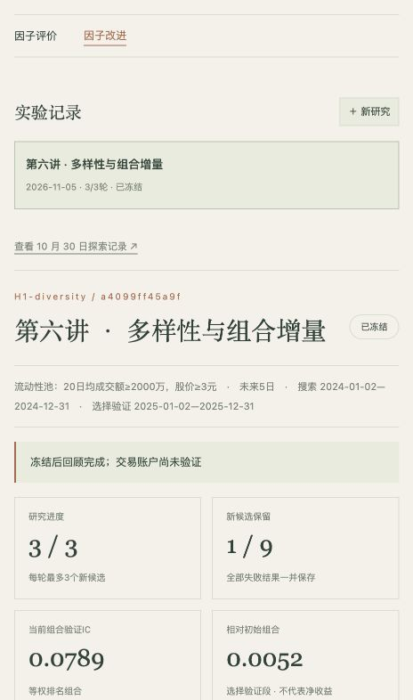

作业提交｜穿石因子实验室：多样性与组合增量驱动的因子改进

[代码与使用说明](https://github.com/Chuboxiao/stoneflow-quant/blob/main/README_EVOLUTION.md) · [真实实验报告](https://github.com/Chuboxiao/stoneflow-quant/blob/main/results/evolution_runs/a4099ff45a9f/REPORT.md) · [全部候选与反馈](https://github.com/Chuboxiao/stoneflow-quant/blob/main/results/evolution_runs/a4099ff45a9f/study.json)

把因子改进做成了本机实验室中的可操作模块：创建实验 → 多家族候选 → 同口径评价 → 组合增量筛选 → 反馈 → 下一轮 → 冻结与回顾。支持规则提案和Agent候选导入、完整失败记录、重复公式拦截、关闭页面后继续及中断恢复。

本次研究使用5,451个输入证券代码，逐日筛选历史非ST和流动性股票池；2024搜索、2025选择验证，冻结后检查2026年1—9月。5个起始因子、3轮9个新候选，接受1个：十日反转替换五日反转，最终与20日低波动组成两个家族的等权秩组合。

| 指标 | 初始因子池 | 冻结因子池 |
| --- | ---: | ---: |
| 2025选择验证 Rank IC | 0.0738 | 0.0789 |
| 2026冻结后回顾 Rank IC | 0.0404 | 0.0520 |
| 2026正IC月份 | 4/9 | 6/9 |
| 2026 Q5−Q1平均未来5日报价收益 | −0.1080% | −0.0751% |

一个有用的淘汰案例：10日低波动单因子IC高于20日版本，但替换后组合验证IC没有改善，所以没有保留。多样性也不是只看家族名称或低相关性，而是检查对现有组合是否真正有增量。

Harness改动包括独立实验状态、两段质量门槛、家族/相关性筛选、组合增量、失败反馈与冻结约束。第1轮由确定性规则提出候选，第2、3轮由Codex根据实测反馈提出并导入；没有后台LLM调用或模型训练，没有H0/H1同预算对照，因此不声称已经证明Harness本身更优。

104项单元测试通过，14个候选通过截断未来数据的因果性核对，53份逐日诊断共13,511项独立核对通过。2026历史此前已查看，属于回顾性研究；分组收益差仍为负且未扣费，新组合尚未完成净交易验证，不能解释为已获得更赚钱的策略。

下载仓库后可直接打开`report_site/evolution.html`阅读只读交互快照；连接课程数据后可在本机页面继续创建和运行研究。
